# Security-System 🔒
A Verilog HDL implementation of a digital security system providing coded access control to a secured area.
##
A Verilog HDL description of a security system that provides coded access to a secured area. The provided module needs debugging and polishing to be completed.The development done using ModelSIM.


## 📚 Table of Contents
*   [🌟 Features](#-features)
*   [💻 Tech Stack](#-tech-stack)
*   [🚀 Installation](#-installation)
*   [💡 Usage](#-usage)
*   [🛠️ How to Use](#%EF%B8%8F-how-to-use)
*   [📂 Project Structure](#-project-structure)
*   [📜 License](#-license)

## 📝 Description
This project presents a digital security system implemented in Verilog HDL. The system requires a user to enter a 4-digit code via a keypad to gain access to a secured area. It started as a port of a textbook VHDL reference design and evolved into a full redesign — more on that below.

## ⚠️ Design Evolution 

The original design, taken from a digital systems textbook, uses an **asynchronous timing-based approach**. The sequencing of operations is controlled entirely by one-shot timers — two of them chained together — instead of a proper controller. The idea is that each one-shot fires after a fixed pulse width, giving the downstream logic "enough time" to settle before the next stage latches data.

In practice, this turned out to be very hard to debug. The timing between the one-shots and the data signals is not guaranteed — if the pulse width is too short, the shift registers latch garbage. If it's too long, the system is just slow for no reason. There's no way to formally verify that the timing is correct without running a simulation and viewing waveforms.

After going through the full debugging cycle on the original design — tracking down race conditions, wrong clock edges, and uninitialized signals in simulation — I decided the right move was to rebuild it properly rather than keep patching this architecture.

The new version uses a **synchronous FSM/Datapath architecture**:

- A **control unit (FSM)** drives the sequencing explicitly through defined states
- A **datapath** handles all the data movement — BCD encoding, register latching, comparison, alarm shifting
- Everything is clocked on a single system clock — no one-shots, no asynchronous timing, no pulse widths to tune
- Behavior is deterministic and formally verifiable

The FSM based design has the edge over the async one because it simplifies the debugging and extending the device.

The original async implementation is preserved in the repo for reference, since going through it was genuinely useful for understanding why the synchronous approach is better.

## 🔄 System Flow

The system follows this sequence:

1. Initialize all registers
2. Wait for `#` (Enter) to be pressed — this loads the code selection logic
3. User enters a digit via keypad
4. The digit is BCD encoded and latched alongside the expected digit from the DIP switches
5. Comparator checks if they match
6. On a match: alarm shift register shifts by one, code selection advances to the next digit
7. On a mismatch: code selection resets, user must start over from digit 1
8. After 4 correct digits in sequence: alarm output goes high

## 🌟 Features ( **in works** )

- 4-digit coded access control via 10-key keypad
- DIP switch-settable secret code
- Full reset on wrong digit entry — no partial credit
- Synchronous single-clock design (FSM version)
- Alarm output via serial shift register
- Verified via ModelSim testbench simulation
- Synthesizable on Xilinx Spartan FPGA

## 💻 Tech Stack

- **Hardware Description Language**: Verilog HDL
- **Simulation**: ModelSim / Icarus Verilog + GTKWave
- **Target Hardware**: Xilinx Spartan FPGA (Vivado toolchain)

## 🚧 Current Status

The FSM/Datapath redesign is actively in progress. Right now I am working through:

- **Block diagram** — clean separation of datapath components and control signals, figuring out exactly what wires go where and which signals are combinational vs sequential
- **Moore FSM design** — state diagram with clearly defined states, transition conditions, and output signals (y1..yn) for each state
- **Schematic implementation** — drawing the full system schematic showing the FSM control unit, datapath components, and all interconnections

The async implementation in the repo is the reference point for what the system is supposed to do. The FSM version will replace it once the design is finalized and verified in simulation.

## 🚀 Installation
To simulate or synthesize this Verilog project, you will need a Verilog simulator and/or an FPGA/ASIC synthesis toolchain. No specific installation steps are required for the Verilog files themselves, as they are source code.

1.  **Clone the repository**:
    ```bash
    git clone https://github.com/SilentDevC/Security-System.git
    cd Security-System
    ```

2. Choose a toolchain:
    - **Icarus Verilog + GTKWave** — free, great for simulation
    - **ModelSim** — what this was developed and debugged on
    - **Vivado** — for synthesis and FPGA deployment

## 🛠️ How to Use

### Simulation (Icarus Verilog + GTKWave)
```
1.  **Compile with Icarus Verilog**:
    ```bash
    iverilog -o secsys_sim secsys.v secsys_tb.v
    ```
2.  **Run Simulation**:
    ```bash
    vvp secsys_sim
    ```
3.  **To generate a waveform file for GTKWave:**
    ```bash
    iverilog -o secsys_sim secsys.v secsys_tb.v
    vvp secsys_sim -lxt2
    ```
4.  **View Waveforms with GTKWave**:
    ```bash
    gtkwave dump.lxt
    ```

5.  **Or you can choose another Verilog Toolchain**:
    *   **ModelSim / QuestaSim (Commercial)**: Comprehensive simulation and debugging.
    *   **Vivado / Quartus (Commercial)**: For FPGA synthesis and implementation (Xilinx and Intel/Altera respectively).
```
## 💡 Usage
This project's primary use case is in digital logic design for embedded systems where secure access is required. It can be simulated to verify its functionality or synthesized onto an FPGA board for a real-world demonstration of a coded entry system.

### Real-world Use Cases:
*   **Home Automation**: Implementing a simple keypad entry for a smart lock system.
*   **Embedded Security**: Basic access control for industrial equipment or secure data storage units.
*   **Educational Purposes**: A practical example for students learning sequential logic, state machines, and Verilog HDL.

## 🛠️ How to Use
To interact with and utilize the `secsys.v` module, you would typically follow these steps:

### 1. Simulation (using ModelSIM)

1.  **Create a Testbench**.
    ```verilog
    // Example of a basic testbench structure (this is the actual part of the testbench from the project )
    module testsecuresys;
    reg [9:0] key;
    reg enter;
    reg clk;
    reg res;
    reg [3:0] dip1, dip2, dip3, dip4;
    wire sysout;

    secsys test (.key(key), .enter(enter), .clk(clk), .res(res),
                 .dip1(dip1), .dip2(dip2), .dip3(dip3), .dip4(dip4),
                 .sysout(sysout));

    localparam clockcycle = 10;
    always #(clockcycle/2) clk = ~clk;

    initial begin
        // set secret code via DIP switches
        dip1 = 4'h4; dip2 = 4'h5; dip3 = 4'h6; dip4 = 4'h7;

        res = 0; #20 res = 1;

        // press # to initialize
        #10 enter = 1; #10 enter = 0;

        // enter digits...
    end
    endmodule
2. Run Simulation using the ModelSIM GUI and view the resulting wavefrom.

### 2. Synthesis (for FPGA)

1.  **Add `secsys.v` to your FPGA Project**: Create a new project in your preferred FPGA IDE (e.g., Vivado, Quartus).
2.  **Define Top-Level Module**: Ensure `secsys.v` is the top-level module or is instantiated within one.
3.  **Create Constraints File (XDC/SDC)**: Define pin assignments, clock frequencies, and other timing constraints relevant to your target FPGA board.
4.  **Synthesize and Implement**: Run the synthesis, implementation (placement and routing), and bitstream generation flow in your FPGA IDE.
5.  **Program FPGA**: Load the generated bitstream onto your FPGA development board.
6.  **Test Hardware**: Interact with the system on the hardware using physical inputs (e.g., buttons, switches) and observe outputs (e.g., LEDs, 7-segment displays).

## 📂 Project Structure
```
Security-System/
├── README.md
├── LICENSE
└── secsys.v   ← all modules + testbench
```

## 🖥 Old Asynchronous Design 


## ⚙ New FSM based Synchronous design


**Both designs use the Code Selector logic circuit which holds the correct pattern**
##

##
## ⚖ LICENSE  
MIT License. See [LICENSE](LICENSE) for details.
