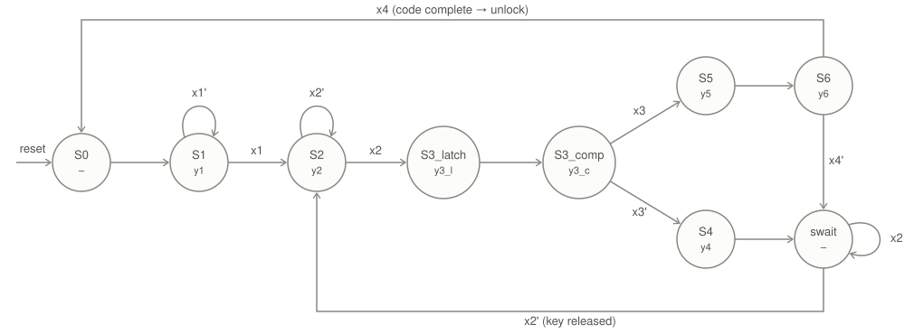

# Security-System 🔒
A Verilog HDL implementation of a digital security system providing coded access control to a secured area.


## 📚 Table of Contents
*   [📝 Description](#-description)
*   [⚠️ Design Evolution](#️-design-evolution)
*   [🔄 System Flow](#-system-flow)
*   [🌟 Features](#-features)
*   [💻 Tech Stack](#-tech-stack)
*   [🚧 Current Status](#-current-status)
*   [🚀 Installation](#-installation)
*   [🛠️ How to Use](#️-how-to-use)
*   [💡 Usage](#-usage)
*   [📂 Project Structure](#-project-structure)
*   [🖼 Diagrams](#-diagrams)
*   [⚖ License](#-license)

## 📝 Description
This project is a digital security system written in Verilog HDL. The user enters a 4-digit code on a keypad, and the system compares it digit by digit against a secret code set on DIP switches. After four correct digits in a row, the output goes high.

It started as a port of a textbook VHDL reference design and evolved into a full redesign using a synchronous FSM/Datapath architecture. More on that below.

## ⚠️ Design Evolution

The original design, taken from a digital systems textbook, uses an **asynchronous timing-based approach** (preserved as `secsys(old_async_design).v`). Its sequencing is controlled by two chained one-shot timers instead of a controller. Each one-shot fires after a fixed pulse width, giving the downstream logic "enough time" to settle before the next stage latches data.

In practice this was very hard to debug. The timing between the one-shots and the data signals is not guaranteed: if the pulse width is too short, the shift registers latch garbage; if it is too long, the system is slow for no reason. The only way to check the timing is to simulate and inspect waveforms.

After a full debugging cycle on the original design (race conditions, wrong clock edges, uninitialized signals), I decided to rebuild it properly rather than keep patching that architecture.

The new version uses a **synchronous FSM/Datapath architecture**:

- A **control unit (Moore FSM)** drives the sequencing explicitly through defined states.
- A **datapath** handles the data movement: BCD encoding, register latching, comparison and the output shift register.
- Everything runs on a single system clock. There are no one-shots and no pulse widths to tune.
- Behavior is deterministic and can be traced state by state in simulation.

The FSM-based design makes the device easier to debug and extend. Moving to a single clock did expose a few issues:

1. Registers without a hold mode shifted on every clock edge.
2. The FSM compared old register values, because the registers updated on the same edge the decision was made.
3. The PISO output was read one state before its shift took effect.
4. A held key was counted as several presses.
5. Asynchronous inputs could cause metastability.

To solve them:

- The combined SH/LD control on the shift registers and the code selection logic was split into separate **SH** (shift) and **LD** (load) signals, so the registers can **hold** when neither is asserted.
- The FSM was expanded from 6 to 9 states:
  - Separate **latch** and **compare** states, so the comparator always sees the new values.
  - A **check** state after each shift, so the PISO output has settled before the FSM reads it.
  - A **wait** state (`swait`), which holds while a key is still pressed, so one press counts as one digit.
- A two-flip-flop **synchronizer** in the top module aligns the keypad and enter inputs to the system clock before they reach the rest of the design.

The original async implementation is kept in the repo for reference, since working through it was genuinely useful for understanding why the synchronous approach is better.

## 🔄 System Flow

1. **Reset:** the FSM goes to its initial state.
2. **Wait for `#` (Enter):** the code selection logic and the output shift register are loaded.
3. **Wait for a key:** the user presses a digit on the keypad.
4. **Latch:** the BCD-encoded digit and the expected digit from the DIP switches are latched into registers A and B.
5. **Compare:** the comparator checks whether they match.
6. **On a match:** the output shift register shifts once and the code selection advances to the next digit. The next state checks whether all four digits are done.
7. **On a mismatch:** the code selection and the output shift register are reloaded, and the user starts over from digit 1.
8. **Wait for key release** before accepting the next digit.
9. **After 4 correct digits:** the output (`sysout`) goes high.

### FSM states

Moore state diagram: each state shows its name and its output; edge labels are the input conditions (`'` = not).



| State | Output | Action | Next state |
|---|---|---|---|
| `S0` | – | Reset / start | `S1` |
| `S1` | `y1` | Load code selector and shift register C | `S2` when Enter is pressed |
| `S2` | `y2` | Wait for a key | `S3_latch` when a key is pressed |
| `S3_latch` | `y3_l` | Latch entered and expected digit into registers A and B | `S3_comp` |
| `S3_comp` | `y3_c` | Compare | `S5` on match, `S4` on mismatch |
| `S4` | `y4` | Wrong digit: reload code selector and shift register C | `swait` |
| `S5` | `y5` | Correct digit: shift code selector and shift register C | `S6` |
| `S6` | `y6` | Check whether the code is complete | `S0` if done (unlock), else `swait` |
| `swait` | – | Wait for key release | `S2` when the key is released |

Control signals: `ld = y1 | y4`, `sh = y5`, and registers A/B load when `y3_l` is high.

## 🌟 Features

- 4-digit coded access control via a 10-key keypad
- Secret code set on DIP switches
- Full reset on a wrong digit; no partial credit
- Synchronous single-clock Moore FSM/Datapath design
- Input synchronizer for the asynchronous keypad and Enter signals
- Key-release detection, so a held key is counted once
- Verified in simulation with a self-contained testbench (Icarus Verilog + GTKWave)

## 💻 Tech Stack

- **Hardware Description Language:** Verilog HDL
- **Simulation:** Icarus Verilog + GTKWave (originally developed in ModelSim)
- **Target hardware:** Xilinx Spartan FPGA

## 🚧 Current Status

The FSM/Datapath redesign is complete and passes the simulation testbench: a correct 4-digit sequence drives `sysout` high.

Next steps:

- **Unlocked state:** at the moment `sysout` is a short pulse; a dedicated state would hold it until relocked
- **FPGA synthesis** on a Spartan board, with a resource utilization and timing report
- **Negative test cases** in the testbench (wrong codes, held keys)

## 🚀 Installation
No installation is needed for the Verilog sources themselves; you only need a simulator and, optionally, an FPGA toolchain.

1.  **Clone the repository:**
    ```bash
    git clone https://github.com/SilentDevC/Security-System.git
    cd Security-System
    ```

2.  **Choose a toolchain:**
    - **Icarus Verilog + GTKWave:** free, used for the current simulation flow
    - **ModelSim / QuestaSim:** used during early development
    - **Vivado:** for synthesis and FPGA deployment

## 🛠️ How to Use

### Simulation (Icarus Verilog + GTKWave)

The testbench (`testsecuresys`) is included at the end of `secsys.v`, so a single file is enough.

1.  **Compile:**
    ```bash
    iverilog -o secsys.v.out secsys.v
    ```
2.  **Run the simulation:**
    ```bash
    vvp secsys.v.out
    ```
    This prints the progress of the input sequence and writes `wave.vcd`.
3.  **View the waveforms:**
    ```bash
    gtkwave wave.vcd
    ```

The testbench sets the secret code on the DIP switches, releases reset, presses Enter and then enters the four digits:

```verilog
module testsecuresys;
    reg [9:0] key;
    reg enter, clk, res;
    reg [3:0] dip1, dip2, dip3, dip4;
    wire sysout;

    secsys test (.key(key), .enter(enter), .clk(clk), .res(res),
                 .dip1(dip1), .dip2(dip2), .dip3(dip3), .dip4(dip4),
                 .sysout(sysout));

    localparam clockcycle = 20;
    always #(clockcycle/2) clk = ~clk;

    initial begin
        $dumpfile("wave.vcd");
        $dumpvars(0, testsecuresys);
        // set the secret code, release reset, press Enter,
        // then enter the four digits one key press at a time
    end
endmodule
```

### Synthesis (FPGA)

1.  **Create a project** in Vivado (or your preferred FPGA IDE) and add `secsys.v`, without the testbench module.
2.  **Set `secsys` as the top-level module.**
3.  **Write a constraints file (XDC)** with pin assignments for the keypad, DIP switches, Enter, reset, clock and output LED.
4.  **Run synthesis and implementation**, then generate the bitstream.
5.  **Program the board** and test with the physical inputs.

## 💡 Usage
The design can be simulated to check its behavior, or synthesized onto an FPGA as a hardware demonstration of a coded entry system. It is also a compact example of sequential logic, Moore FSM design and FSM/Datapath partitioning in Verilog.

## 📂 Project Structure
```
Security-System/
├── README.md
├── LICENSE
├── .gitignore
├── secsys.v                            ← FSM/Datapath design + testbench
├── secsys(old_async_design).v          ← original async design (reference)
├── fsm_state_diagram.svg               ← Moore FSM state diagram
├── code_lock_schematic_v8.svg          ← FSM-based datapath schematic
├── security_code_logic_circuit.svg     ← code selection logic
└── security_system_block_diagram.svg   ← original async block diagram
```

## 🖼 Diagrams

### 🖥 Old Asynchronous Design


### ⚙ New FSM-Based Synchronous Design


### Code Selection Logic
Both designs use this circuit to select the expected code digit. In the FSM design, its shift register has separate SH and LD inputs.



## ⚖ License
MIT License. See [LICENSE](LICENSE) for details.
